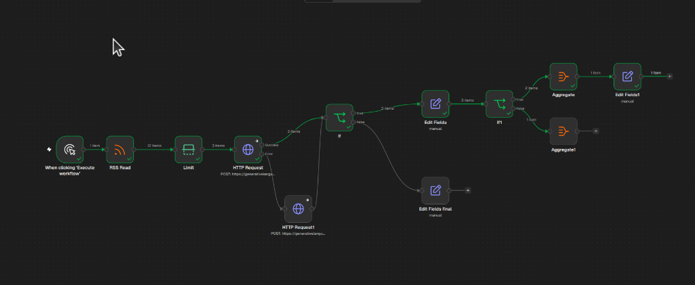

# Aula 05 — Orquestração de Múltiplas Etapas (Lotes, Filtragem e Agregação)

**Trilha:** Orquestração de IA
**Ferramentas:** n8n (`Limit`, `If`, `Aggregate`, `Edit Fields`), RSS, Gemini API
**Status:** Concluída (em 08/11/2026).

## 1. Objetivo da aula

Sair do processamento de **1 notícia isolada** (com *Execute Once*) e construir um **pipeline completo de múltiplas etapas** capaz de:
1. Controlar o tamanho do lote antes de chamar a IA (usando o node **Limit** para não estourar a cota por minuto);
2. Processar múltiplas notícias em sequência pela IA e separar automaticamente as relevantes das irrelevantes no **If1**;
3. Reunir (agregar) todas as notícias aprovadas em um único **Boletim TechPulse** consolidado usando o node **Aggregate**.

---

## 2. Conceitos

### O que é Orquestração de Múltiplas Etapas?

Até a Aula 04, olhamos para uma única chamada de IA isolada: entra 1 notícia → sai 1 JSON classificado.

Em sistemas reais de Engenharia de IA, um pipeline é composto por várias etapas coordenadas (**orquestração**), onde cada etapa tem uma responsabilidade clara:

```text
[Coleta: RSS] 
   ↓ (21 itens brutos)
[Etapa 1: Pré-processamento / Limit]  ← Custo zero (filtra/limita antes da IA)
   ↓ (3 itens selecionados)
[Etapa 2: Enriquecimento com IA]      ← Custo de API (classifica e resume cada item)
   ↓ (3 itens enriquecidos)
[Etapa 3: Curadoria / Filtro (If1)]   ← Decisão semântica (separa relevante = true)
   ↓ (ex.: 2 itens aprovados, 1 descartado)
[Etapa 4: Consolidação (Aggregate)]   ← Junta os itens aprovados em um único pacote
```

---

### Regra de Ouro: Filtrar e Limitar *antes* da IA

Na Aula 03, ativamos o **Execute Once** dentro das configurações do `HTTP Request` para não disparar 21 requisições de uma vez para o Gemini.

Porém, o *Execute Once* tem uma limitação: ele trava o node em **apenas 1 item**. Se você quiser processar as **3 ou 5 últimas notícias** do feed sem estourar o limite gratuito do Gemini (que costuma ser de 5 a 15 requisições por minuto, dependendo do modelo), a ferramenta correta é o node **Limit** colocado **antes** do `HTTP Request`.

> **Princípio de arquitetura:** Nunca jogue uma lista aberta de tamanho desconhecido direto em um node de IA. Sempre controle o volume antes com `Limit`, `Filter` ou `Remove Duplicates`.

---

### Item por Item (Fan-out) vs. Pacote Único (Aggregate / Fan-in)

No n8n, cada notícia é um **item separado** na lista.
- Se 3 notícias entram no `HTTP Request`, ele roda **3 vezes** (uma para cada notícia).
- Se 2 notícias passam pelo `If1` (`relevante: true`), saem **2 itens separados** na True Branch.

Mas e se no final do fluxo você quiser enviar **1 único e-mail / mensagem** com o resumo do dia, ou salvar **1 boletim diário** contendo a lista das notícias aprovadas?
- Se você conectar um node de envio direto depois do `If1`, ele vai enviar **2 e-mails separados** (um para cada item)!
- Para juntar vários itens de volta em **1 único item contendo uma lista**, usamos o node **Aggregate**.

---

## 3. Exercícios práticos

### Exercício 1 — Trocar o "Execute Once" pelo node `Limit` (Processamento em Lote)

Vamos permitir que o nosso pipeline processe **3 notícias por execução**, em vez de apenas 1:

1. No seu canvas atual, clique no sinal de `+` na linha que liga o **`RSS Read`** ao **`HTTP Request`** (principal) e adicione o node **Limit**.
2. Configure o **Limit** com:
   - **Max Items:** `3`
   - **Keep:** `First Items`
3. Agora abra o node **`HTTP Request`** (principal):
   - Vá na aba **Settings** (no topo do node) e **desative** a chavinha **Execute Once** (deixe cinza/desligada).
   - *(Faça o mesmo no `HTTP Request1` de fallback, caso o Execute Once também esteja ligado nele).*
   - **Dica de cota:** se a cota do `gemini-3.8-flash` estiver baixa hoje, você pode colocar a URL do `gemini-flash-lite-latest` já no `HTTP Request` principal, pois ele tem limite muito mais folgado para rodar 3 itens seguidos!
4. Clique em **Execute workflow** (no botão da tela principal) e observe a mágica no canvas:
   - Do `RSS Read` saem **21 items**;
   - Do `Limit` saem **3 items**;
   - O `HTTP Request` processa os **3 items**;
   - E no final, lá no **`If1`**, veja quantos itens saíram em **`true`** (relevantes) e quantos saíram em **`false`** (descartados)!

*(Aproveite para corrigir no `Edit Fields` aquele espacinho no final do nome do campo `"categoria "` → `"categoria"`, se ainda não tiver tirado!)*

---

### Exercício 2 — Consolidar as notícias aprovadas com o node `Aggregate`

Agora vamos pegar apenas as notícias que saíram na porta **`true`** do **`If1`** (ou seja, as que a IA julgou relevantes para desenvolvedores) e juntá-las em um único pacote:

1. Clique no `+` da saída **`true`** do node **`If1`** e adicione o node **Aggregate**.
2. Em **Aggregate**, configure:
   - **Aggregate:** `All Item Data (Into a Single List)`
   - **Put Output in Field:** digite `noticias_aprovadas`
3. Clique em **Execute step** no node `Aggregate`.
4. Veja o **Output**:
   - Antes do `Aggregate`, você tinha *N* itens separados (ex.: `2 items` ou `3 items`).
   - Agora você tem **`1 item`** apenas, que contém um array chamado `noticias_aprovadas` com todas as notícias relevantes agrupadas lá dentro!

---

### Exercício 3 — Montar o "Boletim TechPulse" final (`Edit Fields`)

Para fechar o pipeline com chave de ouro, vamos adicionar um último **Edit Fields** depois do `Aggregate` para gerar o objeto final do boletim diário (pronto para ser salvo em banco ou enviado por API/Webhook):

1. Adicione um node **Edit Fields** após o **Aggregate** (renomeie para `Boletim TechPulse`, se quiser).
2. Adicione os seguintes campos (Manual Mapping):
   - **`data_geracao`** (String):
     `{{ $now.toFormat('dd/MM/yyyy HH:mm') }}`
   - **`total_aprovadas`** (Number):
     `{{ $json.noticias_aprovadas.length }}`
   - **`destaques`** (Array):
     `{{ $json.noticias_aprovadas }}`
3. Execute o node e confira o JSON final gerado!

> **O que acabamos de construir?**
> Esse fluxo (`RSS Read → Limit → Gemini (+ Fallback) → Validação → Edit Fields → Filtro Semântico (If1) → Aggregate → Boletim TechPulse`) já é praticamente o **coração do MVP do TechPulse**!



---

## 4. O que deve ficar no diário

- Por que usar o node **Limit** antes da IA em vez de deixar o fluxo aberto ou usar *Execute Once*.
- Como o n8n processa múltiplos itens em paralelo/sequência e os divide entre os ramos `true` e `false` do `If1`.
- Para que serve o node **Aggregate** (transformar *N* itens individuais de volta em 1 único item consolidado) e por que isso evita disparos duplicados no fim de um workflow.
- Quantas das 3 notícias do seu teste passaram como `relevante: true` e quantas foram barradas no `false`.

