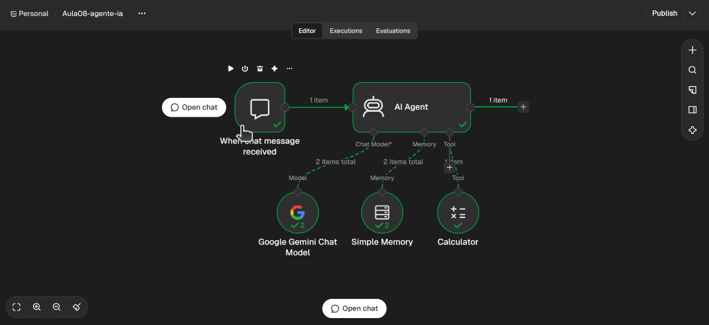
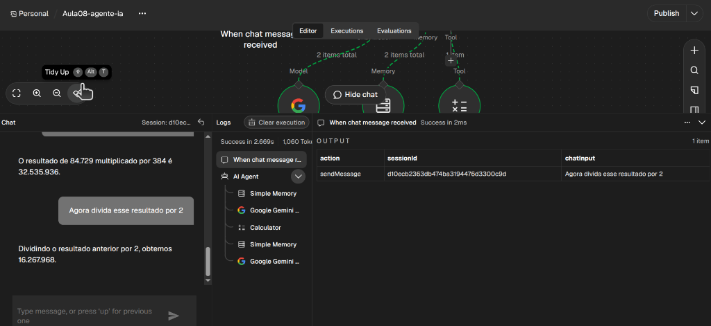

# Aula 08 — Function Calling e Construção do Primeiro Agente de IA

**Trilha:** Agentes de IA e Function Calling  
**Ferramentas:** n8n (`AI Agent`, `Google Gemini Chat Model`, `Window Buffer Memory`, `Tools`), Gemini API  
**Status:** Concluída (em 11/11/2026).

---

## 1. Objetivo da aula

Entender a mecânica do **Function Calling** (como o modelo "decide" pausar a conversa e pedir a execução de uma ferramenta) e construir na prática o seu **primeiro Agente Autônomo com Ferramentas e Memória** no n8n.

---

## 2. Conceitos Fundamentais

### O que é Function Calling (ou Tool Calling)?

Modelos de linguagem (LLMs) são redes neurais isoladas da internet: eles **não têm acesso direto a bancos de dados, APIs ou calculadoras**.

Para resolver isso, os provedores (Google, OpenAI, Anthropic) criaram o **Function Calling**:
1. Você passa para o modelo uma lista de **ferramentas disponíveis**, cada uma com um nome, descrição e parâmetros esperados (em formato JSON Schema);
2. Quando o usuário faz uma pergunta que o modelo não sabe de cabeça (ou que exige uma ação no mundo real), o modelo **não responde em texto**.
3. Em vez disso, ele devolve uma mensagem especial dizendo:
   ```json
   {
     "functionCall": {
       "name": "calcular",
       "args": { "expressao": "439 * 12.5" }
     }
   }
   ```
4. O seu sistema (o n8n ou o seu backend) executa essa função e devolve o resultado cru para o modelo (`functionResponse`);
5. O modelo lê o resultado e finalmente formula a resposta em linguagem natural para o usuário!

---

### A Diferença entre Prompt Estruturado (Aula 04) e Function Calling (Aula 08)

- **Na Aula 04 (Prompt Estruturado):** Você pediu: *"Classifique a notícia e me devolva o resultado final em JSON"*. O modelo respondeu diretamente para você.
- **Na Aula 08 (Function Calling):** O modelo diz: *"Para eu conseguir responder à sua pergunta, eu preciso que você execute a ferramenta X com os parâmetros Y e me traga o resultado antes que eu fale com o usuário"*.

---

### A Tríade do Agente no n8n

No n8n, um Agente não é um único nó isolado, mas sim um nó central conectado a 3 componentes:

```text
               ┌──────────────────────────────┐
               │    When Chat Message Received│ (Chat Trigger)
               └──────────────┬───────────────┘
                              │
                    ┌─────────▼─────────┐
                    │     AI AGENT      │
                    │  (Orquestrador)   │
                    └────┬─────────┬────┘
                         │         │
       ┌─────────────────┘         └─────────────────┐
       ▼                                             ▼
┌──────────────┐                             ┌──────────────┐
│  Chat Model  │                             │    Tools     │
│Google Gemini │                             │ Calculadora, │
│(Cérebro/LLM) │                             │ Busca, etc.  │
└──────────────┘                             └──────────────┘
       ▲
       │
┌──────────────┐
│    Memory    │
│Window Buffer │
│(Curto prazo) │
└──────────────┘
```

1. **Trigger (Disparador):** `When chat message received` (permite conversar com o agente numa janelinha de chat direto no n8n).
2. **Model (Cérebro):** `Google Gemini Chat Model` (conecta à API do Gemini).
3. **Memory (Memória):** `Window Buffer Memory` (lembra das últimas mensagens trocadas).
4. **Tools (Ferramentas):** `Calculator` ou ferramentas customizadas (para ações específicas).

---

## 3. Exercícios Práticos

### Exercício 1 — Montar a estrutura do Agente no n8n

1. No n8n, crie um novo workflow (clique no menu superior esquerdo → **New workflow**).
2. Adicione o gatilho **When chat message received** (Chat Trigger).
3. Conecte nele o node **AI Agent**:
   - Tipo de Agente: **Tools Agent** (o padrão ReAct).
4. Repare que o node **AI Agent** tem 3 portas na parte inferior esperando conexões:
   - **Model**
   - **Memory**
   - **Tool**

---

### Exercício 2 — Conectar o Cérebro (Gemini) e a Memória

1. Na porta **Model** do AI Agent, adicione o node **Google Gemini Chat Model**.
2. Na configuração da credencial (**Credential for Google Gemini**):
   - Clique em **Create New Credential**;
   - Nome do tipo de credencial: **Google Gemini(PaLM) API**;
   - Cole a sua **API Key** do Google AI Studio (a mesma chave que você já usou no Header Auth nas aulas anteriores);
   - Selecione o modelo: `gemini-1.5-flash` ou `gemini-2.0-flash` (ou `gemini-flash-latest`).
3. Na porta **Memory** do AI Agent, adicione o node **Window Buffer Memory**:
   - Deixe o tamanho de contexto padrão (Session Key: `sessionId`).

---

### Exercício 3 — Entregar a primeira Ferramenta (`Calculator`) e Testar o Loop ReAct

Por que uma calculadora? Porque LLMs não sabem fazer contas complexas de verdade (eles tentam "adivinhar" o próximo número por probabilidade estatística). Entregar uma calculadora é o teste perfeito de Tool Calling!

1. Na porta **Tool** do AI Agent, adicione o node **Calculator**.
2. Clique no botão **Chat** (no canto inferior esquerdo do canvas ou no botão "Open chat").
3. **Teste 1 (Pergunta comum — sem ferramenta):**
   - Envie: *"Olá! Quem é você e o que você sabe fazer?"*
   - Observe a resposta: o agente responde diretamente usando seu conhecimento prévio, **sem chamar nenhuma ferramenta**.
4. **Teste 2 (Pergunta matemática — disparo de Tool):**
   - Envie: *"Quanto é 84729 multiplicado por 384?"*
   - Observe o comportamento do agente:
     - Ele detecta que precisa de cálculo exato;
     - Ele dispara a Tool `Calculator`;
     - Ele recebe o resultado exato (`32.535.936`) e devolve a resposta final!
5. **Teste 3 (Validação da Memória):**
   - Envie em seguida: *"Agora divida esse resultado por 2"*.
   - Veja o agente buscar na memória o número anterior, acionar a calculadora de novo e entregar a resposta certa!

#### Resultados Reais dos Testes no Canvas e Chat

| Estrutura do Agente de IA no n8n | Interação no Chat com Function Calling e Memória |
|:---:|:---:|
|  |  |

**Validação do Comportamento Autônomo:**
1. **Intenção sem Tool:** À pergunta *"quem é você e o que vc sabe fazer?"*, o modelo respondeu com seu conhecimento de linguagem natural sem acionar ferramentas.
2. **Disparo de Tool (Function Calling):** À pergunta matemática `84.729 * 384`, o modelo detectou a necessidade de cálculo exato, disparou o node `Calculator` e devolveu `32.535.936`.
3. **Persistência de Memória de Curto Prazo:** À instrução *"Agora divida esse resultado por 2"*, o modelo recuperou o valor anterior do `Simple Memory`, acionou novamente a `Calculator` e calculou `16.267.968`.

---

## 4. O que deve ficar no diário

- A diferença técnica entre pedir JSON no prompt (Aula 04) e o mecanismo de **Function Calling** (Aula 08).
- Como funciona o handshake do Function Calling (`functionCall` com argumentos ➔ execução externa ➔ `functionResponse` ➔ resposta final).
- Por que ferramentas (*Tools*) eliminam deficiências estruturais de modelos de linguagem (ex.: alucinação em matemática ou falta de dados em tempo real).
- Registro do teste real do seu primeiro Agente funcionando no chat do n8n.

