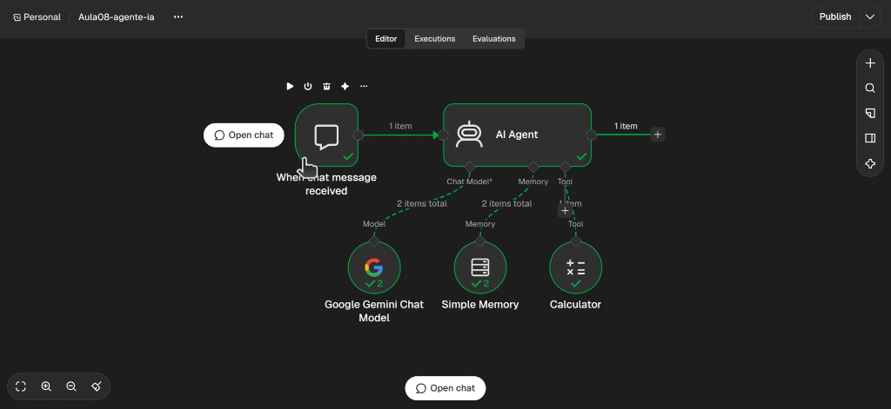
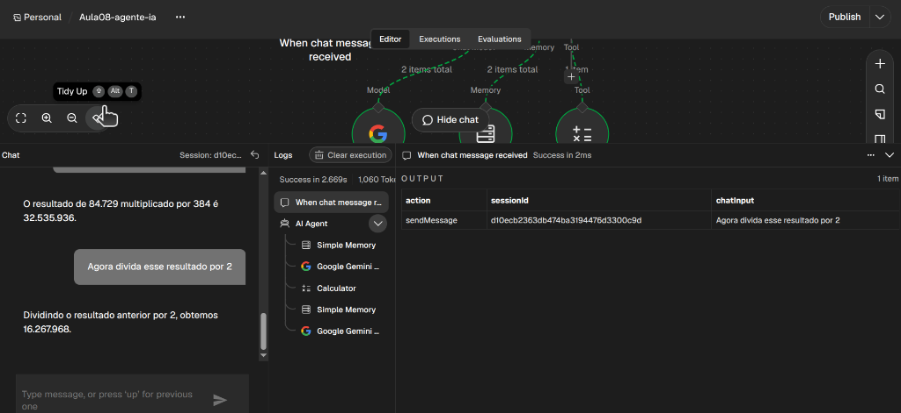
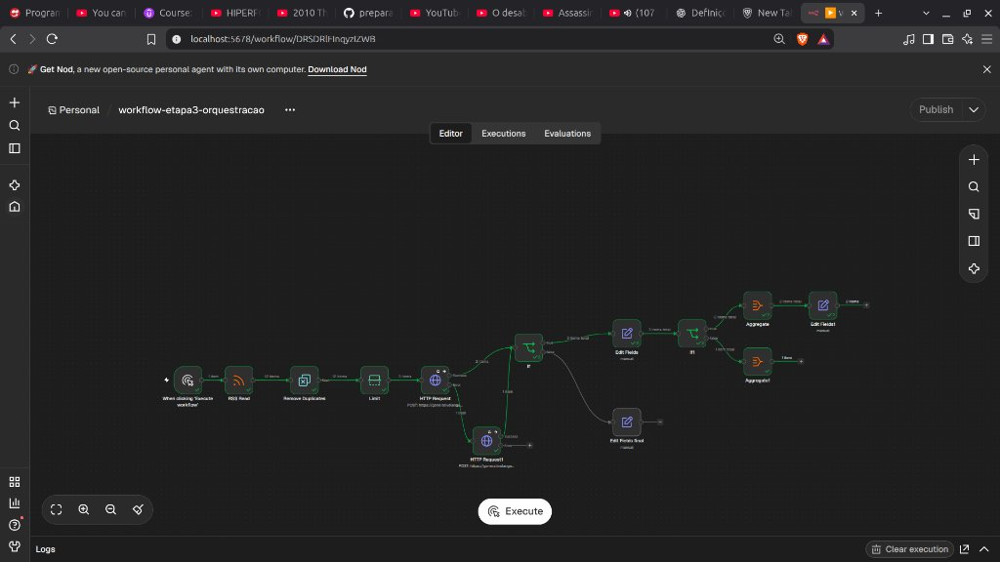
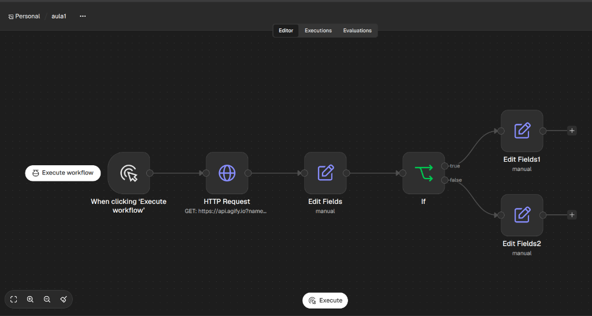
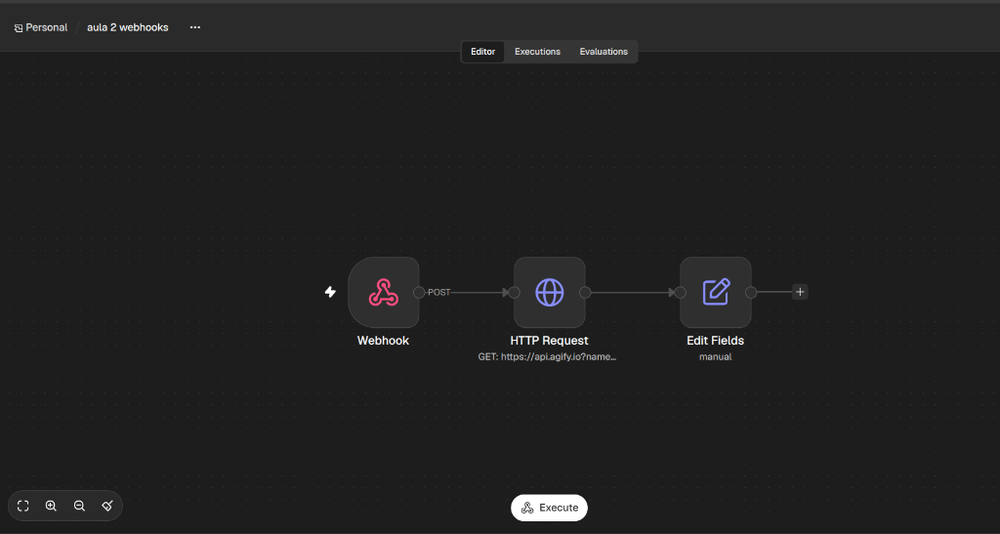
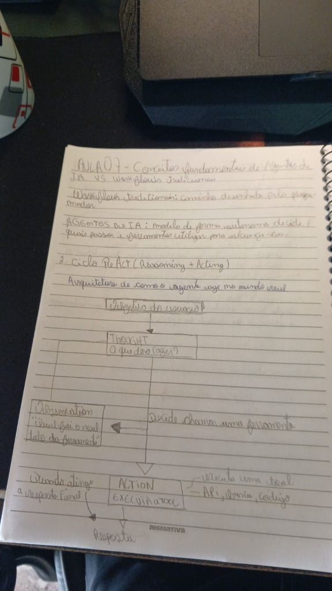
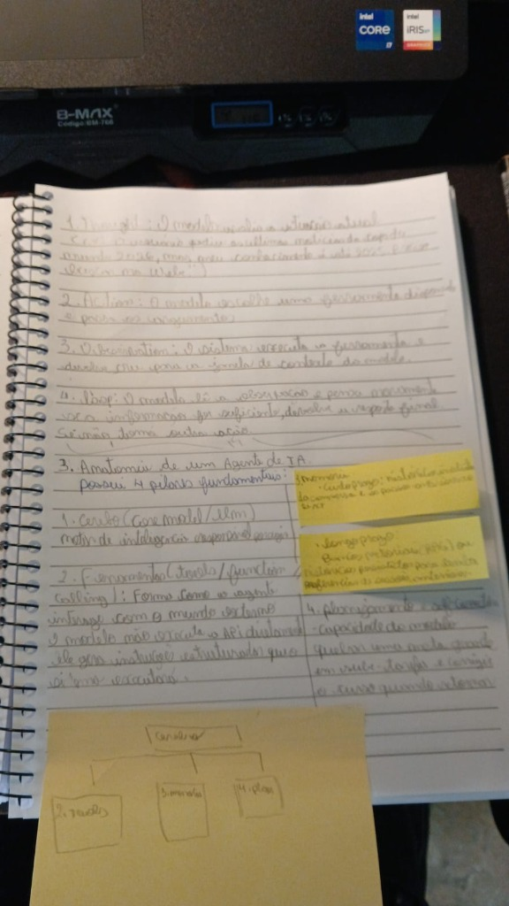

# Preparação para o Programa de Estágio em GenAI — iFood

Repositório dedicado à minha preparação técnica para o Programa de Estágio em GenAI do iFood, com foco na construção de soluções utilizando Inteligência Artificial, automação de processos, integração de APIs e orquestração de workflows.

O objetivo é transformar o aprendizado teórico em experiências práticas, desenvolvendo soluções que utilizem IA para resolver problemas reais.

## Objetivos

- Compreender os fundamentos de automação e orquestração de processos.
- Desenvolver habilidades com ferramentas como n8n.
- Aprender a consumir, integrar e manipular APIs.
- Explorar a integração de modelos de linguagem (LLMs) em aplicações.
- Desenvolver workflows inteligentes e automatizados.
- Compreender os conceitos de agentes de IA e Function Calling.
- Construir projetos práticos que demonstrem a aplicação desses conhecimentos.

## Trilha de estudos e documentação

> 📖 Acompanhe o registro detalhado de cada experimento, erros enfrentados e decisões técnicas no **[Diário de Aprendizado](docs/diario-de-aprendizado.md)** e o cronograma completo no **[Plano de Estudos](docs/plano-de-estudos.md)**.

| Etapa | Conteúdo | Materiais e Práticas | Status |
|---|---|---|---|
| 01 | Fundamentos de automação | [Aula 01 — Fundamentos](01-automacao/aula-01-fundamentos.md) · [Interface do n8n](01-automacao/interface-n8n.md) | 🟢 Concluído |
| 02 | n8n e construção de workflows | Condicionais (`IF`), manipulação JSON e expressões | 🟢 Concluído |
| 03 | APIs, HTTP e Webhooks | [Aula 02 — Webhooks e API REST](02-apis-e-integracoes/aula-02-webhooks-e-api-rest.md) | 🟢 Concluído |
| 04 | Integração e orquestração de IA | [Aula 03 — RSS e Gemini](03-orquestracao-ia/aula-03-rss-e-gemini.md) · [Aula 04 — Prompts e JSON](03-orquestracao-ia/aula-04-prompts-e-json-estruturado.md) · [Aula 05 — Orquestração](03-orquestracao-ia/aula-05-orquestracao-multiplas-etapas.md) · [Aula 06 — Resiliência](03-orquestracao-ia/aula-06-tratamento-erros-retries-deduplicacao.md) | 🟢 Concluído |
| 05 | Agentes de IA e Function Calling | [Aula 07 — Conceitos](04-agentes-ia/aula-07-conceitos-de-agentes-ia.md) · [Aula 08 — Function Calling](04-agentes-ia/aula-08-function-calling-e-agentes-pratica.md) | 🟡 Em andamento |
| 06 | Projeto prático — TechPulse | Integração end-to-end do MVP | ⚪ Não iniciado |
| 07 | Preparação técnica para entrevistas | Revisão conceitual e portfólio | ⚪ Não iniciado |

## Evolução prática no n8n (TechPulse Pipeline)

Durante as etapas de automação e orquestração de IA, o pipeline do **TechPulse** foi evoluído incrementalmente no **n8n** (self-hosted via Docker):

### Etapa 4 — Agente Autônomo de IA com Function Calling e Memória
Construção de agente autônomo baseado no padrão ReAct, conectando o cérebro (**Google Gemini Chat Model**), memória de curto prazo (**Simple Memory**) e ferramenta externa (**Calculator**). O agente decide autonomamente quando responder com linguagem natural e quando pausar a execução para disparar uma ferramenta com parâmetros estruturados:

| Estrutura do Agente de IA no n8n | Interação no Chat com Tool Calling e Memória |
|:---:|:---:|
|  |  |

### Etapa 3 — Orquestração com IA, Fallback de Modelos, JSON Estruturado, Agregação e Resiliência
Pipeline completo integrando coleta de feeds RSS, deduplicação na fonte (`Remove Duplicates`), controle de lote (`Limit`), classificação e resumo com a **API do Google Gemini** (`responseMimeType: "application/json"`), **tentativas automáticas (Retries)**, arquitetura de **fallback automático entre modelos** para resiliência contra limites de cota (`429`/`503`), curadoria semântica condicional (`If`) e consolidação de boletins (`Aggregate`):



<details>
<summary><strong>📸 Ver workflows das Etapas 1 e 2 (Fundamentos, APIs REST e Webhooks)</strong></summary>

<br>

**Etapa 1 — Consumo de API REST (`api.agify.io`), manipulação de campos e ramificação condicional (`IF`):**


**Etapa 2 — Recepção de eventos via Webhook (`POST`) e enriquecimento de dados com API externa:**


</details>

## Projetos e experimentos

### LinkedIn AI Post Generator

Aplicação desenvolvida em Python e Streamlit, integrada à API do Google Gemini, para auxiliar na geração estruturada de publicações para o LinkedIn.

**Tecnologias:** Python, Streamlit, Google Gemini API e JSON.

### TechPulse

Projeto em desenvolvimento conceitual, planejado para automatizar a coleta, classificação e síntese de notícias sobre tecnologia.

A proposta é integrar fontes RSS, processamento com IA e armazenamento de informações em uma plataforma de acompanhamento tecnológico.

**Tecnologias planejadas:** React, TypeScript, Node.js, MongoDB, Gemini API e n8n.

### GitQuest

Aplicação educacional desenvolvida com HTML, CSS e JavaScript, com o objetivo de ensinar conceitos e operações do Git por meio de uma experiência interativa e gamificada.

## Organização do repositório

```text
preparacao-estagio-ifood/
├── README.md
├── compose.yml
├── docs/
│   ├── assets/
│   ├── plano-de-estudos.md
│   ├── diario-de-aprendizado.md
│   └── referencias.md
├── 01-automacao/
│   ├── aula-01-fundamentos.md
│   └── interface-n8n.md
├── 02-apis-e-integracoes/
│   └── aula-02-webhooks-e-api-rest.md
├── 03-orquestracao-ia/
│   ├── aula-03-rss-e-gemini.md
│   ├── aula-04-prompts-e-json-estruturado.md
│   ├── aula-05-orquestracao-multiplas-etapas.md
│   └── aula-06-tratamento-erros-retries-deduplicacao.md
├── 04-agentes-ia/
│   ├── aula-07-conceitos-de-agentes-ia.md
│   └── aula-08-function-calling-e-agentes-pratica.md
├── 05-projeto-pratico/
└── 06-preparacao-entrevista/
```

A estrutura será ampliada conforme os estudos e experimentos evoluírem.

### Rodando o n8n localmente

O ambiente de automação (n8n) roda via Docker Compose:

```bash
docker compose up -d
```

A interface fica disponível em `http://localhost:5678`.

## Metodologia

A preparação é organizada em três frentes complementares:

- **Teoria:** compreensão dos conceitos e fundamentos técnicos, estruturados e desenhados à mão no caderno (diagramas de arquitetura, tabelas comparativas e esquemas de dados).
- **Prática:** construção de workflows, experimentos com LLMs e pipelines automatizados no n8n.
- **Documentação:** registro sistemático diário de aprendizados, dificuldades enfrentadas e soluções no Git.

### Estudo Teórico e Arquitetura Conceitual

| Diagrama do Ciclo ReAct (Agentes de IA) | Anatomia de um Agente e Ferramentas |
|:---:|:---:|
|  |  |

<details>
<summary><strong>📖 Ver galeria completa das anotações no caderno (Aulas 01 a 07)</strong></summary>

<br>

- **Aula 01 — Fundamentos de Automação:** [Página 1](docs/assets/caderno/aula-01-caderno-pag1.jpg) · [Página 2 (Workflow & Nodes)](docs/assets/caderno/aula-01-caderno-pag2.jpg) · [Página 3 (Triggers & HTTP)](docs/assets/caderno/aula-01-caderno-pag3.jpg)
- **Aula 02 — Webhooks e API REST:** [Página 1 (Anatomia do Webhook)](docs/assets/caderno/aula-02-caderno-pag1.jpg) · [Página 2 (HTTP Request vs Webhook)](docs/assets/caderno/aula-02-caderno-pag2.jpg)
- **Aula 03 — RSS e Gemini API:** [Página 1 (RSS & API de IA vs API de Dados)](docs/assets/caderno/aula-03-caderno-pag1.jpg)
- **Aula 04 — Prompts e JSON Estruturado:** [Página 1 (4 Pilares de Prompt & JSON.parse)](docs/assets/caderno/aula-04-caderno-pag1.jpg)
- **Aula 05 — Orquestração de Múltiplas Etapas:** [Página 1 (Pipeline & Determinismo)](docs/assets/caderno/aula-05-caderno-pag1.jpg) · [Página 2 (Lotes, Fan-out/Fan-in & Agregação)](docs/assets/caderno/aula-05-caderno-pag2.jpg)
- **Aula 06 — Resiliência e Deduplicação:** [Página 1 (Retries & Deduplicação por Link)](docs/assets/caderno/aula-06-caderno-pag1.jpg) · [Página 2 (3 Camadas de Defesa em IA)](docs/assets/caderno/aula-06-caderno-pag2.jpg)
- **Aula 07 — Conceitos de Agentes de IA:** [Página 1 (Ciclo ReAct)](docs/assets/caderno/aula-07-caderno-pag1.jpg) · [Página 2 (Anatomia do Agente com Post-its)](docs/assets/caderno/aula-07-caderno-pag2.jpg)

</details>

Cada atividade relevante registra:

1. Objetivo.
2. Conceitos estudados.
3. Aplicação prática.
4. Dificuldades encontradas.
5. Soluções desenvolvidas.
6. Aprendizados e próximos passos.

## Acompanhamento

O progresso será atualizado conforme a conclusão das atividades, mantendo uma distinção entre conteúdos estudados, experimentos realizados e funcionalidades efetivamente implementadas.

---

**Objetivo final:** desenvolver a capacidade de construir soluções inteligentes, integrando software, automação e Inteligência Artificial para resolver problemas de maneira prática e eficiente.

## Contato

**Vinicius Menegussi** — [LinkedIn](https://www.linkedin.com/in/vinicius-menegussi-dev)