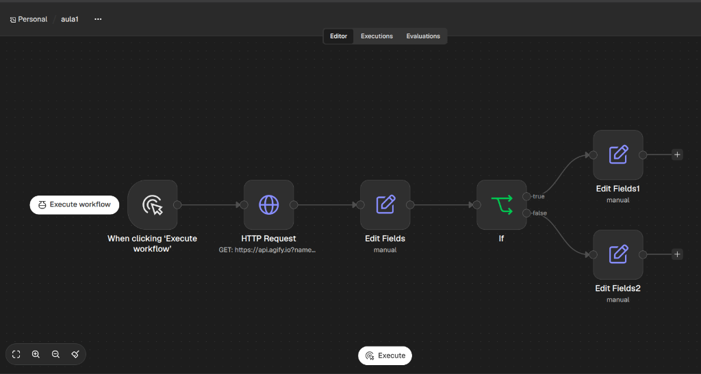
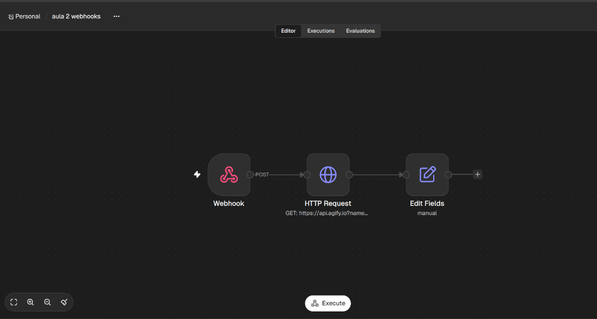
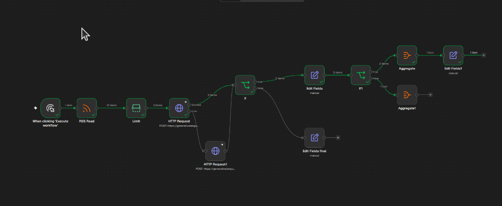
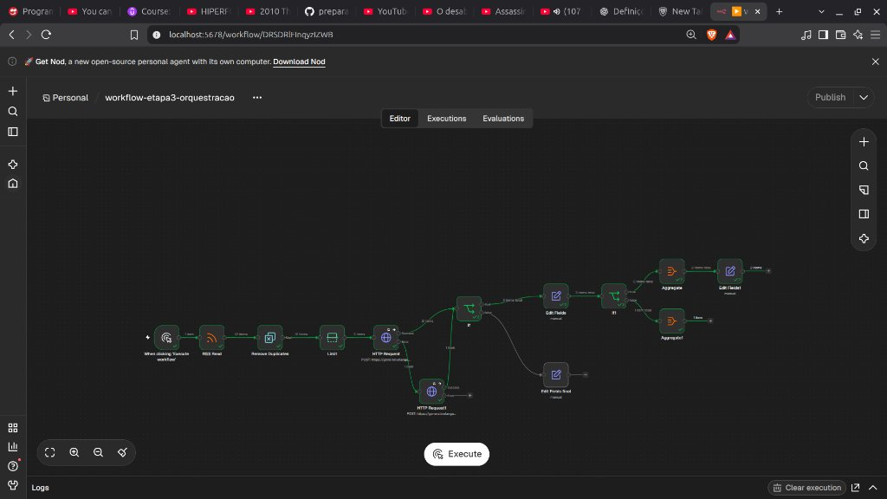
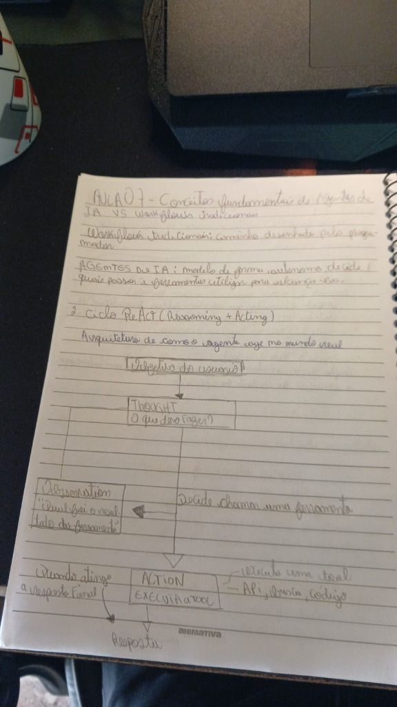
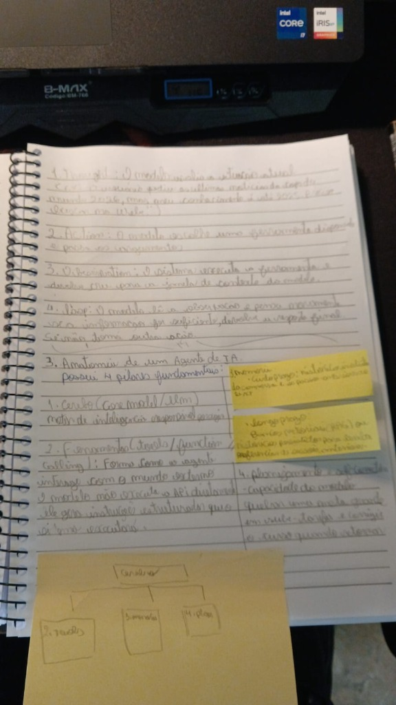
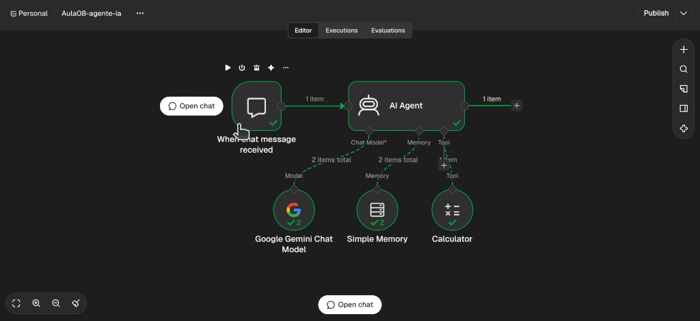
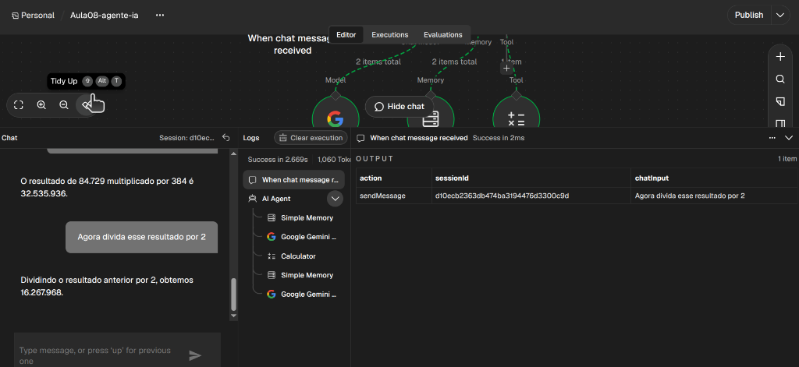

# Diário de Aprendizado

## 30/10/2026 — Etapa 1, Aula 01: Fundamentos de automação com n8n

> Conteúdo completo da aula e exercícios de modelagem em [01-automacao/aula-01-fundamentos.md](../01-automacao/aula-01-fundamentos.md).

### Automação e Orquestração de Sistemas

1. **Automação** — executar tarefas/processos repetitivos com pouca ou nenhuma intervenção humana, ganhando consistência e reduzindo erro manual.
2. **Workflow** — o processo inteiro, representado como uma sequência de etapas (nodes) conectadas.
3. **Node** — uma etapa individual do workflow, responsável por uma operação específica (ex.: HTTP Request, IF, Filter).
4. **Trigger** — o que decide *quando* o workflow começa (Schedule, Webhook, Manual, RSS Trigger).
5. **Action** — o que decide *o que fazer* dentro do workflow (consultar API, salvar dado, enviar e-mail).
6. **JSON** — formato de dados que circula entre os nodes; cada node pode consumir o output do anterior (ex.: `{{ $json.title }}`).
7. **API e HTTP Request** — forma de integrar o workflow com sistemas externos, usando métodos GET/POST/PUT/PATCH/DELETE.
8. **Condicionais** — o node IF, que avalia uma condição e direciona o fluxo por caminhos diferentes (True/False).
9. **Credenciais** — forma seguro de autenticar em serviços externos (API keys, tokens, OAuth) sem expor segredos no código.
10. **Tratamento de erros** — prever falhas (API fora do ar, token inválido, limite de requisição) e decidir a reação (retry, log, notificação).

### Exercício 1 — Questionário de fixação

Ainda não respondido formalmente — os conceitos foram absorvidos e aplicados direto nos exercícios de modelagem abaixo.

### Exercício 2 — Workflow do TechPulse

1. **Schedule Trigger** — inicia a execução diariamente às 8h.
2. **RSS Feed Read** — consulta a fonte RSS de notícias.
3. **Filter** — seleciona apenas notícias relevantes (tecnologia).
4. **Gemini** — classifica a notícia e gera um resumo.
5. **Database** — armazena o resultado.

### Exercício 3 — Desafio: automação de atendimento/cadastro

1. **Form Trigger / Webhook** — recebe os dados do formulário.
2. **IF** — valida se o e-mail foi preenchido e é válido.
   - **True:** armazena o cliente, define status, envia confirmação por e-mail.
   - **False:** registra como pendente, solicita e-mail válido.

### Dificuldades encontradas

Nenhuma barreira conceitual grave; o ponto de atenção foi diferenciar **RSS Feed Read** (consulta agendada) de **RSS Trigger** (reage a nova publicação) — ambos parecem a mesma coisa à primeira vista, mas têm gatilhos diferentes.

### Aprendizados e próximos passos

Entendido o vocabulário base (workflow, node, trigger, action, JSON, API, IF, credenciais, erros) e a diferença entre automação tradicional e automação com IA embarcada (classificação/resumo).

**Próximo passo:** sair da modelagem no papel e abrir o n8n de fato — instalar (self-hosted local via Docker, conforme recomendado na aula) e construir o primeiro workflow real com Trigger + HTTP Request + IF.

**Atenção ao cronograma:** este conteúdo era do dia 30/10, mas foi concluído em 01/11 — ajustar o ritmo ou compactar as próximas etapas para não comprometer o prazo de inscrição (17/11).

## 01/11/2026 — Primeiro workflow real no n8n

Construído e testado no n8n (self-hosted, Node 26 LTS): **Manual Trigger → Edit Fields (nome, email, idade) → If (idade > 19) → Edit Fields (status: aprovado | status: pendente)**.

Validação:
- `idade = 19` → caiu no **False Branch** → `status: pendente` ✓
- `idade = 20` → caiu no **True Branch** → `status: aprovado` ✓

Workflow executado com sucesso nos dois cenários, confirmando o entendimento de condicionais (IF) e branches na prática. Primeira entrega da Etapa 1 cumprida.

**Próximo passo:** trocar o Edit Fields inicial por um node HTTP Request consumindo uma API real.

## 01/11/2026 (cont.) — HTTP Request com API real

Workflow evoluído para: **Manual Trigger → HTTP Request (GET api.agify.io?name=vinicius) → Edit Fields → If (age > 19) → Edit Fields (status: aprovado | pendente)**.

Erro encontrado: após trocar o HTTP Request, o fluxo continuou caindo no False Branch mesmo com `age: 29` retornado pela API — o Edit Fields do meio ainda tinha o campo `idade` fixado manualmente em 19 (resquício do exercício anterior) e o If ainda lia `{{ $json.idade }}` em vez de `{{ $json.age }}`. Corrigido removendo o valor manual e trocando a expressão do If para o campo correto.

Validação final: `age: 29` → **True Branch** → `status: aprovado` ✓. Workflow executado com sucesso.



**Aprendizado:** dado estático deixado em um node anterior pode mascarar silenciosamente um dado novo vindo de uma API — sempre conferir se o nome do campo usado nas expressões bate com o que a fonte de dados realmente retorna.

**Próximo passo:** Webhook (etapa 2) e explorar mais a fundo tratamento de erros/condições na resposta da API (ex.: o que fazer se a API não retornar `age`).

## 01/11/2026 (cont.) — Interface do n8n

Revisão guiada da interface: barra lateral (Assistant, Overview, Templates, Insights, Settings → Credentials), barra superior do workflow (Editor, Executions, Evaluations, Publish) e painel de detalhe do node (Input/Output, Schema/Table/JSON, Execute step, Docs).

Guia de referência completo salvo em [01-automacao/interface-n8n.md](../01-automacao/interface-n8n.md) para consulta futura.

**Etapa 1 — Fundamentos de automação: concluída. ✅**

---

## 02/11/2026 — Etapa 2, Aula 02: Webhooks e fundamentos de API REST

> Conteúdo e exercícios em [02-apis-e-integracoes/aula-02-webhooks-e-api-rest.md](../02-apis-e-integracoes/aula-02-webhooks-e-api-rest.md).
>
> **Praticado de fato em 04/11** (troca de PC entre 02 e 03/11 atrasou a execução — conteúdo já estava documentado, só faltou a prática).

### Conceitos

- **Webhook** — trigger que inicia o workflow quando recebe uma requisição HTTP externa, ao contrário do Schedule/Manual Trigger.
- **Diferença entre HTTP Request e Webhook (cliente vs. servidor)** — no HTTP Request o n8n é cliente (consulta uma API externa); no Webhook o n8n é servidor (expõe uma URL que outros sistemas chamam).
- **Segurança básica de webhooks** — Test URL só funciona uma vez por clique em "Listen"; em produção, validar sempre o dado recebido e considerar autenticação.

### Exercício 1 — Primeiro Webhook (Postman → n8n)

Testado com Postman em vez de curl. Fluxo: configurar node Webhook (POST) → copiar Test URL → "Listen for test event" → enviar POST no Postman com body JSON (`nome`, `email`, `idade`).

**Erro encontrado:** na primeira tentativa, o `body` chegou como string bruta (`"{\n  \"nome\": ...}"`), com header `content-type: text/plain`. Causa: no Postman, Body → raw estava com o dropdown em "Text" em vez de "JSON", então o Content-Type não foi setado corretamente.

**Correção:** trocado o dropdown pra "JSON" no Postman. Resultado: `body` chegou como objeto JSON de verdade (`content-type: application/json`), com `nome`, `email` e `idade` acessíveis diretamente via `{{ $json.body.idade }}`.

### Exercício 2 — Webhook + validação (If)

Reaproveitada a lógica do If (`idade > 19`) já validada na Aula 01, trocando a expressão para `{{ $json.body.idade }}` (dado agora chega aninhado em `body`). Testado com `idade: 10` via Postman → caiu corretamente no **False Branch**. Confirma que a lógica de condição independe da origem do dado (manual, API externa ou evento via Webhook).

### Exercício 3 — Desafio: Webhook + HTTP Request (mini-TechPulse orientado a evento)

Workflow duplicado a partir do anterior (pra preservar os Exercícios 1/2) e montado: **Webhook (recebe `title`, `url`) → HTTP Request (GET api.agify.io, simulando enriquecimento) → Edit Fields (combina os dois)**.

**Erros encontrados e corrigidos:**
1. Tentativa inicial no modo "JSON" do Edit Fields sem sintaxe de objeto válida (faltavam chaves, aspas e vírgulas) → erro de validação.
2. Ao trocar para modo "Fixed"/Manual Mapping, o nome do campo e a expressão foram digitados juntos na mesma caixa (`titulo: {{ ... }}`) — o n8n entendeu isso como nome de campo e trocou sozinho pra aba "Expression", deixando o valor vazio. Corrigido separando: caixa de **nome** só com `titulo`, caixa de **value** com a expressão.
3. Resquício do erro anterior: sobrou um `:` no final dos nomes dos campos (`"titulo:"`, `"url:"`, `"relevancia_estimada:"`). Corrigido removendo o `:` de cada nome.

**Resultado final:**
```json
{
  "count": 439,
  "name": "ia",
  "age": 54,
  "titulo": "iFood lança novo modelo de IA",
  "url": "https://exemplo.com/noticia",
  "relevancia_estimada": "54"
}
```

Combinação de dado do Webhook (2 nodes atrás, via `$('Webhook').item.json...`) com dado do HTTP Request (node imediatamente anterior, via `$json...`) funcionando no mesmo item.



### Dificuldades encontradas

- Confundir o Content-Type de uma requisição manual (Postman) é um erro comum e realista — o mesmo aconteceria com qualquer cliente HTTP mal configurado. Boa lição sobre nunca assumir o formato do dado recebido sem checar.
- No Edit Fields, misturar nome do campo com a expressão no mesmo input, e diferença entre os modos "Fixed" e "JSON" do node — cada um exige uma sintaxe diferente.
- Entender que `$json` sempre refere ao node imediatamente anterior, e que pra pegar dado de um node mais atrás no fluxo é preciso referenciar pelo nome com `$('NomeDoNode')`.

### Aprendizados e próximos passos

Entendido o papel do Webhook como "porta de entrada" de eventos externos, a importância do header `Content-Type`, e — o aprendizado mais valioso do dia — como combinar dados de múltiplos nodes anteriores (não só o imediato) dentro de um mesmo item, técnica essencial para o pipeline do TechPulse (coletar → enriquecer → organizar).

**Etapa 2 — Lógica e integração de APIs: concluída. ✅**

---

**Retomar depois:** seguir para Etapa 3 — Integração e orquestração de IA (06/11).

## 04/11/2026 (cont.) — Etapa 3, Aula 03: RSS e primeiros passos com Gemini

> Conteúdo e exercícios em [03-orquestracao-ia/aula-03-rss-e-gemini.md](../03-orquestracao-ia/aula-03-rss-e-gemini.md). Adiantado em relação ao cronograma (previsto para 06/11).

### Conceitos

- **RSS Feed Read** — consulta uma fonte RSS sob demanda; retornou 21 itens de um feed real, cada um com `title`, `link`, `pubDate`, `content`/`contentSnippet`.
- **Diferença entre API "de dado" e API "de IA" (prompt → resposta variável)** — API de dado (agify) sempre retorna o mesmo formato previsível; API de IA (Gemini) recebe um prompt e devolve texto gerado, variável a cada chamada, dentro de um "envelope" JSON (`candidates[0].content.parts[0].text`).
- **Credencial Header Auth (Gemini API key)** — guardada via Settings → Credentials → Header Auth, nunca exposta no node.

### Exercício 1 — Ler fonte RSS real

Configurado RSS Feed Read com feed real (feedburner/TechCrunch). 21 itens retornados, cada um com título, link, data e conteúdo (HTML bruto em `content`, versão limpa em `contentSnippet`).

### Exercício 2 — Enviar notícia pro Gemini

**Erros encontrados e corrigidos, em sequência:**
1. Campo "Name" do header da credencial preenchido com o nome/rótulo da credencial em vez do nome real do header (`x-goog-api-key`) → corrigido editando o campo certo dentro da credencial.
2. "Send Body" desligado → corpo vazio, Gemini reclamando de `contents` não especificado → ligado e configurado em modo JSON.
3. Uso do campo `content` (HTML bruto, cheio de aspas) dentro do prompt quebrou o JSON por aspas não escapadas → trocado para usar só `title` no prompt.
4. Modelo usado: `gemini-3.8-flash` (confirmado como nome atual, substituiu `gemini-3.7-flash` em out/2026).
5. Múltiplos **503 (Service Unavailable)** e um **429 (rate limit)** do Gemini durante os testes — identificados via log do container Docker (`docker compose logs n8n`), já que a chamada roda no backend e não aparece no DevTools do navegador.

### Exercício 3 — Organizar resultado + padrão de fallback

Ao final, decidimos ir além do exercício original e implementar um **padrão de fallback**: HTTP Request principal (`gemini-3.8-flash`) com **Settings → On Error: "Continue (using error output)"**, output de erro conectado a um segundo HTTP Request (fallback, modelo alternativo), e os outputs de sucesso de ambos convergindo no mesmo node **If**.

Armadilha no caminho: tentativa inicial de criar o "If" renomeando um node **Edit Fields** — não funciona, o tipo do node não muda por renomear; foi preciso adicionar um node **If** de verdade.

**Validação estrutural:** confirmado visualmente que a arquitetura está correta (Success → If direto; Error → fallback → If). Testes end-to-end ficaram inconclusivos porque, numa das rodadas, até o modelo de fallback tomou 503 — instabilidade da API gratuita do Gemini no momento, não erro de configuração.

Também ativada a opção **"Execute Once"** no RSS Read, para processar só o primeiro item durante os testes em vez dos 21 de uma vez — reduz o consumo de cota da API enquanto se depura o workflow.

### Dificuldades encontradas

- Diferenciar o "nome da credencial" (rótulo na lista) do "nome do header" (exigido pela API) — dois campos parecidos, fácil de confundir.
- JSON montado por concatenação de string quebra com dado que contém aspas (HTML do RSS).
- Node renomeado não muda de tipo — "If" só existe adicionando o node certo.
- Depurar um node HTTP Request exige olhar o log do backend (Docker), não o DevTools do navegador — a chamada não passa pelo browser.

### Aprendizados e próximos passos

Dia mais denso em debugging real do que os anteriores — quase todos os erros foram de integração (headers, JSON, tipos de node), não de lógica. Também implementado, por iniciativa própria, um padrão de resiliência (fallback entre dois modelos) que vai além do que a aula pedia.

## 04/11/2026 (cont.) — Pipeline RSS → Gemini → If validado de ponta a ponta

Depois da pausa, retestado o fluxo completo. Dois problemas a mais, resolvidos:

1. **Descoberta de modelos via API** — em vez de adivinhar nome de modelo, chamada `GET /v1beta/models` (com a credencial Header Auth) retornou a lista real de modelos disponíveis. Fallback trocado para `gemini-flash-lite-latest` (alias "sempre atual" de um modelo mais leve, pool de capacidade separado do Flash principal).
2. **Erro de tipo no If** — `"Wrong type: '[object Object]' is an object but was expecting a string"`. A condição `{{ $json.candidates }}` + "exists" estava configurada no tipo String, mas `candidates` é array/objeto. Corrigido ligando **"Convert types where required"** no If.

**Resultado final:** `HTTP Request (Error) → HTTP Request1 (fallback, gemini-3.5-flash-lite) → If → True (1 item)`. Pipeline RSS → IA → validação funcionando de ponta a ponta.

**Pendente para a próxima sessão:** adicionar o Edit Fields final no branch True do If, combinando:
```
titulo_original: {{ $('RSS Read').item.json.title }}
link: {{ $('RSS Read').item.json.link }}
resumo_ia: {{ $json.candidates[0].content.parts[0].text }}
```
(atenção ao nome exato do node — é "RSS Read" no canvas atual, não "RSS Feed Read" como no material da aula).

**Etapa 3 (parcial) — RSS + Gemini: arquitetura e fallback validados end-to-end. Falta só o Edit Fields final de organização do resultado.**

## 04/11/2026 (cont.) — Edit Fields final + validação do caminho de erro + descoberta de cota

Fechado o **Edit Fields** do branch True com `titulo_original`, `link` e `resumo_ia` — todos vieram preenchidos corretamente (ver exemplo real no exercício da aula).

**Bug na validação do If:** ao tentar testar o branch False, uma segunda condição vazia (`[empty] is equal to value2`) ficou sobrando, ligada por **OR** à condição original — isso fazia o If sempre cair em "true", mascarando a validação de verdade. Removida a condição extra.

**Teste real do caminho de erro:** forçado um 404 de propósito (nome de modelo inválido no fallback) para validar o branch False. Resultado: If corretamente detectou a ausência de `candidates` e roteou para o **Edit Fields final** (branch de erro), produzindo `{"status": "erro_ia"}`. Confirma o pipeline funcionando nos dois cenários (sucesso e falha total).

**Descoberta importante — painel de cota do Google AI Studio:** consultado o painel de uso (Dashboard → Usage). Confirmado que o **Gemini 3.8 Flash estourou tanto o limite por minuto (12/5) quanto o diário (27/20)** — explica todos os 503/429 do dia. Já o fallback, **Gemini 3.5 Flash Lite**, tinha folga enorme (5/500 por dia). Ou seja: o padrão de fallback implementado não foi só exercício teórico — foi literalmente o que manteve o workflow funcionando durante os testes de hoje. Reset da cota diária é à meia-noite (horário do Pacífico).

**Pendente para a próxima sessão (pequenos ajustes de limpeza):**
- Corrigir nome do campo `"status: "` (sobrou `:` e espaço) para `"status"` no Edit Fields final.
- Reverter a URL do HTTP Request1 de `gemini-xyz-invalido` (usado só pro teste de erro) de volta para `gemini-flash-lite-latest`.

**Etapa 3 (RSS + Gemini + fallback + validação de erro): CONCLUÍDA. ✅** Adiantada em relação ao cronograma original (dias 06 e parte de 07/11 cobertos em 04/11).

**Próximo passo:** os dois ajustes de limpeza acima, depois seguir para os próximos dias da Etapa 3 (engenharia de prompts, orquestração de múltiplas etapas).

---

## 08/11/2026 — Etapa 3, Aula 04: Engenharia de prompts e respostas estruturadas em JSON

> Conteúdo e exercícios em [03-orquestracao-ia/aula-04-prompts-e-json-estruturado.md](../03-orquestracao-ia/aula-04-prompts-e-json-estruturado.md).

### Conceitos

- **Limitação de texto livre em automações:** respostas abertas mudam de formato a cada execução e inviabilizam filtros condicionais (`If`) ou gravação estruturada em banco.
- **Contrato de saída (Schema no prompt) + `generationConfig`:** combinar especificação clara dos campos no prompt (`categoria`, `relevante`, `resumo`, `tags`) com `"responseMimeType": "application/json"` e `"temperature": 0.2` na API do Gemini garante retorno 100% JSON puro (sem cercas Markdown `` ```json ``).
- **JSON dentro de JSON (`JSON.parse`):** a API do Gemini devolve o JSON serializado como string dentro de `candidates[0].content.parts[0].text`. Para extrair cada campo separadamente no n8n, utiliza-se `JSON.parse($json.candidates[0].content.parts[0].text).campo`.

### Exercício 1 e 2 — Prompt estruturado e desempacotamento no `Edit Fields`

1. Limpeza das pendências da sessão anterior (URL do fallback restaurada para `gemini-flash-lite-latest`).
2. Atualizado o JSON Body do `HTTP Request` com papel de curador técnico do TechPulse, lista fechada de categorias, critério booleano de relevância e `generationConfig` (`responseMimeType: "application/json"`).
3. **Erros encontrados e corrigidos:**
   - **Erro `"invalid syntax"` no HTTP Request:** o uso de barras invertidas (`\"`) dentro da expressão JavaScript `{{ ... }}` causou erro de sintaxe no avaliador do n8n. Corrigido simplificando a expressão para `{{ $('RSS Read').item.json.title }}`.
   - **Condição do `If` de validação com `value1` fixo:** o `If` pós-Gemini estava com a string literal `value1` (modo Fixed) + `exists`, fazendo qualquer erro passar pela True Branch e gerando campos `null` no `Edit Fields`. Corrigido trocando para modo **Expression** com `{{ $json.candidates }}` + `exists`.

### Exercício 3 — Decisão de fluxo guiada pela IA (`If1`)

Adicionado o node `If1` após o `Edit Fields` verificando `{{ $json.relevante }}` (`Boolean → is true`).

**Resultado real obtido (2 execuções sobre a notícia *"How I Get Free Traffic from ChatGPT in 2025 (AIO vs SEO)"*):**
```json
[
  {
    "titulo_original": "How I Get Free Traffic from ChatGPT in 2025 (AIO vs SEO)",
    "link": "https://techncruncher.blogspot.com/2025/12/how-i-get-free-traffic-from-chatgpt-in.html",
    "categoria ": "IA",
    "relevante": false,
    "resumo_ia": "O artigo aborda estratégias de otimização para inteligência artificial (AIO) em comparação ao SEO tradicional para atrair tráfego a partir do ChatGPT. O conteúdo é focado em marketing digital e táticas de tráfego, sem apelo técnico para desenvolvedores.",
    "tags": ["ChatGPT", "SEO", "AIO"]
  }
]
```

**Observação importante sobre determinismo em LLMs:**
- Na 1ª execução, o modelo classificou `"categoria": "Negócios Tech"`. Na 2ª execução, classificou `"categoria": "IA"` (ambas da lista permitida, pois o tema cruza ChatGPT com SEO/Marketing).
- Porém, nas **duas execuções** ele manteve `"relevante": false` com consistência total, explicando no resumo que o artigo é focado em marketing/tráfego e não tem apelo técnico para desenvolvedores.
- O node `If1` leu `"relevante": false` e desviou o item corretamente para a **False Branch (`1 item`)**, barrando a notícia irrelevante automaticamente.

### Dificuldades encontradas

- Sintaxe de escape dentro de `{{ ... }}` no n8n: dentro das chaves duplas o código é JavaScript puro, não JSON bruto.
- Lembrar de sempre alternar o campo do `If` de *Fixed* para *Expression* ao avaliar propriedades do `$json`.

### Aprendizados e próximos passos

Compreendido na prática como transformar um LLM (que naturalmente gera texto livre e variável) em um **componente de decisão determinístico** dentro de um pipeline de engenharia, usando `responseMimeType: "application/json"`, `JSON.parse()` e condicionais booleanas.

**Próximo passo:** Aula 05 (09/11) — Orquestração de múltiplas etapas (processar múltiplos itens da lista do RSS, deduplicação/filtragem prévia e encadeamento após o filtro de relevância).

---

## 08/11/2026 (cont.) — Etapa 3, Aula 05: Orquestração de múltiplas etapas (Lotes, Filtro e Agregação)

> Conteúdo e exercícios em [03-orquestracao-ia/aula-05-orquestracao-multiplas-etapas.md](../03-orquestracao-ia/aula-05-orquestracao-multiplas-etapas.md). Adiantado em relação ao cronograma (previsto para 09/11).

### Conceitos

- **Princípio de pré-processamento antes da IA:** nunca enviar uma lista aberta diretamente para uma API de LLM. Usar nodes de custo zero (`Limit`, `Filter`, `Remove Duplicates`) antes do `HTTP Request` para controlar cota e latência.
- **Processamento em lote (Fan-out) vs. Consolidação (Aggregate / Fan-in):** no n8n, múltiplos itens fluem individualmente pelos nodes e se dividem nos ramos `true` e `false` do `If`. O node **Aggregate** reúne os itens aprovados de volta em um único item contendo uma lista (`noticias_aprovadas`), permitindo gerar um único boletim consolidado.

### Exercício 1 — Controle de lote com `Limit` + Feed técnico real (`dev.to/feed`)

1. Adicionado node **Limit** (`Max Items: 3`) entre o `RSS Read` e o `HTTP Request`, e desligado o *Execute Once* do `HTTP Request`.
2. No primeiro teste com o feed antigo (`techncruncher.blogspot.com`), as 3 notícias eram sobre marketing/conteúdo genérico e o Gemini reprovou todas (`relevante: false` → 3 itens na False Branch do `If1`).
3. Trocada a fonte do `RSS Read` para `https://dev.to/feed` (comunidade de desenvolvedores).
4. **Bugs encontrados e corrigidos no `Edit Fields`:**
   - Inicialmente, o campo `relevante` (Boolean) estava com o valor em modo *Fixed* (`false`), sobrescrevendo a resposta do Gemini.
   - Na tentativa de mudar para *Expression*, a expressão foi colada no **1º andar** (nome do campo) em vez do **3º andar** (valor do campo). Corrigido separando nome (`relevante`) no topo e a expressão `{{ JSON.parse($json.candidates[0].content.parts[0].text).relevante }}` na base.
5. **Resultado no `If1`:** das 3 notícias do `dev.to` (em inglês e francês), o Gemini traduziu, resumiu e classificou todas, e o `If1` dividiu o lote automaticamente:
   - **True Branch (`2 items`):** artigo sobre vetorização SVG no browser com *Rust e WebAssembly* (`Engenharia de Software`) e artigo sobre auditoria de hipóteses com *pytest em Python* (`Engenharia de Software`).
   - **False Branch (`1 item`):** artigo em francês sobre o fim de ciclo do headset *Meta Quest 2* (`Outros` / hardware de consumo).

### Exercícios 2 e 3 — Consolidação (`Aggregate`) e Boletim TechPulse (`Edit Fields1`)

1. Conectado o node **Aggregate** na saída `true` do `If1`, agrupando os 2 itens aprovados no array `noticias_aprovadas`, e um **Aggregate1** na saída `false` do `If1` para agrupar separadamente as notícias descartadas pela curadoria.
2. Conectado o **Edit Fields1** final montando o boletim (`data_geracao`, `total_aprovadas` e `destaques`).
3. **Erros encontrados e corrigidos:**
   - Nome do campo no `Aggregate` havia ficado com espaço inicial e acento (`" noticías_aprovadas"`), causando `undefined` em `$json.noticias_aprovadas.length`. Corrigido padronizando o nome para `noticias_aprovadas`.
   - O 3º andar do campo `destaques` (tipo Array) estava em modo *Fixed*, gerando erro de validação de tipo (`expects a array`). Corrigido ativando *Expression*.

#### Arquitetura final do pipeline no n8n (Etapa 3)



### Aprendizados e próximos passos

Construído o núcleo funcional do **TechPulse** de ponta a ponta: `RSS Read → Limit → Gemini (com Fallback) → Validação (If) → Extração JSON (Edit Fields) → Curadoria Semântica (If1) → Consolidação (Aggregate) → Boletim TechPulse (Edit Fields1)`.

**Próximo passo:** fechar o último tópico da Etapa 3 (10/11 — Tratamento de erros, tentativas/retries e deduplicação), consolidando o que já foi adiantado com o padrão de fallback.

---

## 11/11/2026 — Etapa 3, Aula 06: Tratamento de erros, retries nativos e deduplicação

> Conteúdo e exercícios em [03-orquestracao-ia/aula-06-tratamento-erros-retries-deduplicacao.md](../03-orquestracao-ia/aula-06-tratamento-erros-retries-deduplicacao.md).

### Conceitos

- **As 3 Camadas de Defesa em Sistemas com LLM:**
  1. *Camada 1 (Retry Automático com Backoff):* tenta novamente chamadas com falhas passageiras (`503`, glitches de rede) antes de desistir.
  2. *Camada 2 (Fallback Gracioso entre Modelos):* desvia automaticamente para modelo alternativo (`Flash Lite`) caso o principal estoure rate limit (`429`) ou persista com erro.
  3. *Camada 3 (Roteamento de Erro Controlado):* captura falhas no `If` (`candidates exists`) e direciona para fluxo de tratamento sem interromper o pipeline.
- **Deduplicação de Dados (`Remove Duplicates`):**
  - Diferenciação entre deduplicação no lote atual (*Within Current Input*) vs. entre execuções passadas (*In Previous Executions*).
  - Uso do campo `link` (URL imutável) como chave primária para evitar que a mesma notícia consuma tokens repetidos da API do Gemini em coletas periódicas.

### Exercício 1 e 2 — Retries no HTTP Request e Node Remove Duplicates

1. Configurado no node `HTTP Request` principal:
   - `Retry on Fail`: ativado (`Max Tries: 3`, `Wait Between Tries: 2000ms`).
   - `On Error`: `Continue (using error output)`.
2. Adicionado o node **Remove Duplicates** imediatamente após o `RSS Read` comparando por `link`.
3. Executado o workflow de ponta a ponta com notícias reais do `dev.to`.

#### Execução com Resiliência Comprovada no Canvas



**Destaque da execução:**
- O node `HTTP Request` principal processou 2 itens com sucesso e enviou 1 item com erro para a rota de falha.
- O node `HTTP Request1` (fallback com `gemini-flash-lite-latest`) capturou esse item, processou com sucesso e convergiu no node `If`.
- Resultado: 3 itens recuperados, filtrados pelo `If1`, gerando o boletim consolidado no `Edit Fields1` sem nenhuma perda de dados.

### Aprendizados e próximos passos

**Etapa 3 (Integração e Orquestração de IA): CONCLUÍDA COM 100% DE SUCESSO. ✅**

O pipeline do TechPulse agora é um sistema de nível de produção: resiliente a falhas de rede, imune a duplicações de notícias, com controle de lote, curadoria semântica e saída estruturada em JSON.

**Próximo passo:** Etapa 4 — Agentes de IA e Function Calling (11/11: Conceitos de Agentes, loops ReAct e diferenças em relação a workflows tradicionais).

---

## 11/11/2026 (cont.) — Etapa 4, Aula 07: Conceitos fundamentais de Agentes de IA vs. Workflows

> Conteúdo completo em [04-agentes-ia/aula-07-conceitos-de-agentes-ia.md](../04-agentes-ia/aula-07-conceitos-de-agentes-ia.md).

### Conceitos

- **Mudança de Paradigma (Workflow vs. Agente):**
  - No *Workflow*, o desenvolvedor programa a rota exata (início, meio e fim fixos).
  - No *Agente*, o desenvolvedor fornece um objetivo (*Goal*) e um catálogo de ferramentas (*Tools*); o LLM decide a rota, a ordem e quais ferramentas chamar.
- **Loop de Raciocínio ReAct (Reasoning + Acting):**
  - Ciclo iterativo composto por `Thought` (planejar a próxima ação com base no estado atual) → `Action` (disparar uma tool externa) → `Observation` (receber o retorno da tool e injetar no contexto) → `Thought` (avaliar se o objetivo foi atingido ou se precisa de mais ações).
- **Os 4 Pilares da Anatomia de um Agente:**
  1. *Cérebro (LLM):* motor de raciocínio e linguagem.
  2. *Ferramentas (Tools / Function Calling):* ponte para o mundo real (bancos, APIs, web, scripts).
  3. *Memória (Memory):* curto prazo (histórico da conversa/loop) e longo prazo (RAG/vetorial).
  4. *Planejamento (Planning):* decomposição de metas e auto-correção perante erros.
- **Trade-offs de Engenharia (Quando usar cada um):**
  - Workflows: para processos repetitivos, determinísticos, de baixo custo e baixa latência (ex.: emissão de notas, pipelines rígidos como o TechPulse).
  - Agentes: para tarefas investigativas, dinâmicas e com múltiplos caminhos possíveis (ex.: atendimento complexo, análise de fraudes, assistentes autônomos).

#### Anotações e Diagramas no Caderno (Ciclo ReAct e Anatomia)

| Ciclo ReAct (`Thought` ➔ `Action` ➔ `Observation`) | 4 Pilares da Anatomia de um Agente |
|:---:|:---:|
|  |  |

### Aprendizados e próximos passos

Compreendido o conceito teórico que fundamenta os agentes modernos antes de escrever código ou conectar nós no n8n.

**Próximo passo:** Aula 08 (12/11) — Function Calling na prática: como os modelos avisam que querem chamar ferramentas externas com schemas JSON estruturados.

---

## 11/11/2026 (cont.) — Etapa 4, Aula 08: Function Calling e construção do primeiro Agente de IA

> Conteúdo completo em [04-agentes-ia/aula-08-function-calling-e-agentes-pratica.md](../04-agentes-ia/aula-08-function-calling-e-agentes-pratica.md). Adiantado em relação ao cronograma (previsto para 12/11).

### Conceitos

- **Mecânica do Function Calling (Tool Calling):**
  - Modelos de IA não executam código ou acessam APIs diretamente. O modelo recebe a especificação (*JSON Schema*) das ferramentas disponíveis e, ao detectar necessidade, retorna uma requisição estruturada (`functionCall: { name, args }`).
  - O runtime (n8n ou backend) executa a função e devolve o `functionResponse` para o modelo formular a resposta final.
- **A Tríade de um Agente no n8n:**
  - *Trigger:* `When chat message received` (interface interativa de chat).
  - *Orquestrador:* `AI Agent` (modo Tools Agent).
  - *Cérebro:* `Google Gemini Chat Model` (Gemini API).
  - *Memória:* `Simple Memory` (buffer em memória para histórico multi-turn).
  - *Ferramenta:* `Calculator` (garante exatidão matemática de 100%, eliminando a propensão de LLMs a alucinar cálculos).

### Implementação Prática e Validação

Workflow construído no n8n conectando Chat Trigger, AI Agent, Google Gemini, Simple Memory e Calculator:

| Estrutura do Agente de IA no n8n | Interação no Chat com Function Calling e Memória |
|:---:|:---:|
|  |  |

**Cenários Testados e Validados:**
1. **Conversação Pura (Sem Tool):** Ao perguntar *"quem é você e o que vc sabe fazer?"*, o agente respondeu diretamente usando seu conhecimento nativo.
2. **Disparo Autônomo de Ferramenta (Function Calling):** Ao enviar *"Quanto é 84.729 multiplicado por 384?"*, o nó `AI Agent` pausou, acionou a `Calculator` com os argumentos e retornou o valor exato: `32.535.936`.
3. **Memória de Curto Prazo em Ação:** Ao enviar em seguida *"Agora divida esse resultado por 2"*, o agente buscou o valor anterior no `Simple Memory`, acionou novamente a `Calculator` e devolveu `16.267.968`.

### Aprendizados e próximos passos

**Entrega da Etapa 4 concluída:** experimento de agente de IA autônomo funcional com ferramenta e memória implementado com sucesso.

**Próximo passo:** Aula 09 (13/11) — Limitações, supervisão humana (*Human-in-the-loop*), guardrails e segurança de agentes.
